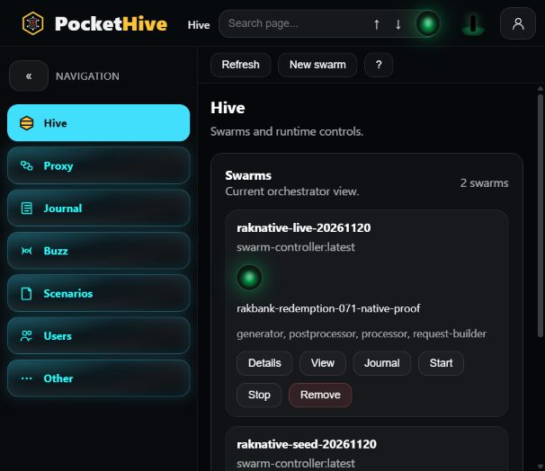

# Native Track2 CVC3: change scope and live verification

Prepared for review on 23 November 2026. Runtime evidence is dated 20 November
2026 UTC; it is not a fresh environment check on the documentation date.

Repository: `sepa79/PocketHive`.
Feature branch: `feature/rakbank-icc-generation`.

## Problem and resulting behavior

Templates already had native EMV key-derivation and ARQC MAC helpers, but lacked
the PPS no-PIN Track2 CVC3 operation needed by the tested contactless redemption
profile. Prepared, one-use Track2 tokens could prove a request, but could not
provide fresh authentication data for repeated use of card metadata.

This change exposes `#pps_cvc3_track2_no_pin(...)` through the existing template
renderer. A bundle supplies the approved clear CVK and coherent card/ATC/UN
inputs, computes CVC3 at request time, and combines it with the existing ARQC
helpers. The request stays in the standard request-builder/processor flow.
There is no runtime Thales SDK, HSM connection, key-file loader or separate
request engine in this implementation.

The canonical input/output and algorithm contract is
[PPS Track2 CVC3 without PIN](../../contracts/template-capabilities.md#pps-track2-cvc3-without-pin).
This review note records intent, affected code and evidence; it does not define
a second crypto contract.

## What belongs in this PocketHive change

| File | Change and reason |
| --- | --- |
| [PpsTrack2Cvc3.java](../../../common/templating/src/main/java/io/pockethive/templating/PpsTrack2Cvc3.java) | New profile-specific calculation. Reuses existing Option A derivation and Algorithm 3 MAC, then existing Bouncy Castle TDES support for the dynamic block. Keeps per-call state and clears derived key/intermediate arrays. |
| [CryptoSpelFunctions.java](../../../common/templating/src/main/java/io/pockethive/templating/CryptoSpelFunctions.java) | Validates the function boundary, calls the calculation and returns three decimal digits with leading zeros. Missing/malformed inputs fail without echoing supplied values. The shared two-digit validation constant is renamed; ARQC validation intent is unchanged. |
| [SpelTemplateEvaluator.java](../../../common/templating/src/main/java/io/pockethive/templating/SpelTemplateEvaluator.java) | Registers the function in the existing evaluator; no parallel expression engine. |
| [PpsTrack2Cvc3Test.java](../../../common/templating/src/test/java/io/pockethive/templating/PpsTrack2Cvc3Test.java) | Synthetic SDK reference vectors through real rendering, padding/format checks, independent per-call state, empty-context syntax validation and value-free failure diagnostics. No issuer key values or SDK binaries are embedded. |
| [Template capabilities](../../contracts/template-capabilities.md#pps-track2-cvc3-without-pin), [templating guide](../../guides/templating-basics.md), [runtime responsibilities](../../architecture/runtime-responsibilities.md) | Describe the explicit profile, use and owner boundary. |
| [Disposable test infrastructure](../../../tools/test/infrastructure.compose.yml) | Run RabbitMQ health diagnostics as the broker user. This addresses a build-fixture startup failure where root-owned Erlang cookie creation caused `eacces`. It is a test-fixture correction, not payment behavior. |

Existing ARQC algorithms are reused. There is no new dependency declaration for
the helper: Bouncy Castle and the EMV/MAC primitives were already present.

The helper's owner boundary is narrow: it calculates CVC3. Key selection and
unwrapping, randomness, ATC allocation, request assembly, transport and card reuse
remain caller/dataflow responsibilities. It does not implement PIN CVC3,
general CVC/CVV generation, arbitrary card profiles, or new exactly-once/card
ownership guarantees. Java-array clearing does not imply erasure of caller-owned
immutable key strings or JVM/provider copies.

## Companion bundle work is a separate review scope

Scenario changes are in `qa-nft-pockethive-bundles`, branch
`feature/rakbank-icc-bundle-worker`. Its `ICC_REQUEST_GUIDE.md` in
`bundles/rakbank-redemption-071-runtime-icc` contains the operator chronology and
full redacted protocol evidence. Those private scenario files are not copied
into PocketHive's application source.

The bundle uses stock generator → native request-builder → ISO processor →
postprocessor. It supplies metadata and a persistent per-card sequence, builds
DE35 and DE127.25, and classifies the response. Two bundle integration issues
were found during proof:

1. Swarm creation replaces worker `config.vars` with a resolved global scenario
   map. The proof consumer therefore uses explicit settings and no global
   variables profile, preserving request-builder-only private key configuration.
   This PR does not change Orchestrator variable precedence.
2. Processor business success is the string `"true"`. The bundle's return route
   was corrected to compare with that string, rather than boolean `true`.
   This PR does not change the processor's response-header contract.

These configuration corrections must accompany the native image when reproducing
the proof. Supplying a key alone does not provide fresh inputs or complete the
end-to-end scenario configuration.

## Recorded validation

| Layer | Evidence and result | Qualification |
| --- | --- | --- |
| Native helper/renderer | 25 `PpsTrack2Cvc3Test` cases, zero failures/errors. | Existing Surefire result dated 19 November 2026; includes 15 synthetic reference cases plus rendering and validation checks. |
| Templating module reports | 96 tests across 10 reports, zero failures/errors. | Historical reports inspected on 23 November; no new test execution was performed for this documentation update. |
| Local build | Control-plane and worker build/test reactors passed; request-builder image contains `PpsTrack2Cvc3`. | Local Linux/WSL build, not registry publication or remote deployment. |
| Bundle regression | Full ISO render/repack, SDK CVC3/ARQC checks, ATC advance, invalid/exhausted metadata, response classification and original-card routing passed. | Companion repository; its later routing regression uses actual string headers. SDK remains a local reference dependency only. |
| Corrected proof catalogue | Zero errors and zero warnings. | Isolated local scenario, with explicit settings and restored catalogue key placeholders. |
| Live issuer proof | One correlated request/response, `0200` → `0210`, DE39 `00`. | Single test-issuer contactless redemption; details below. |

The checked Surefire counts are recorded in
[validation-summary.json](2026-11-20-native-track2-cvc3/validation-summary.json).
They are a dated summary, not a substitute for CI on the eventual PR commit.
The proof ran from the local feature worktree before a feature commit existed;
it is not a green CI result attached to a final immutable PR SHA.

To rerun the module checks in the documented Linux/Java 21 environment:

```bash
./mvnw -pl common/templating -am test
```

Use the repository's [build/use workflow](../../USAGE.md) and
[test strategy](../control-plane-testing.md) for deployment and wider checks.
Rebuild services that consume shared templating before using the new function.

## Actual successful run

PocketHive ran locally in WSL, managed through its public `http://localhost:8088`
UI, and sent the protocol request to a privately configured NFT test issuer.
It used the rebuilt native request-builder with stock workers. No runtime Thales
JAR was loaded and no direct PacSim sender executed this request.

| Field | Recorded value |
| --- | --- |
| Consumer / seeder | `raknative-live-20261120` / `raknative-seed-20261120` |
| Run ID | `d1502bc6-832e-4766-b28a-2cadce490f2b` |
| Processor received / completed UTC | `2026-11-20T00:31:49.994Z` / `2026-11-20T00:31:51.023Z` |
| Amount / currency / entry mode | `000000000100` / `784` / `071` |
| Request / response / response code | `0200` / `0210` / **`00`** |
| STAN / RRN | `000001` / `000000000001` |
| Authorisation ID | `561663` |
| ICC and Track2 ATC | `0003` in both representations |
| ARQC / ICC unpredictable number | `62B4D8E97F7D6C61` / `877B0C0B` |
| Issuer authentication data | `61F3823C834AC5D80012` |
| Reported processor duration | `971 ms` |
| Processor outcome headers | `x-ph-business-code="3030"`, `x-ph-business-success="true"`; `3030` is ASCII-hex `00`. |

The recorded packets fully unpacked with RakBankPackager. PAN, amount, currency,
STAN and RRN correlated, and Track2 matched ICC ATC. The excerpts below retain
the correlation and approval fields. Unrelated fields are omitted; PAN/Track2,
internal endpoints, card inventories, issuer key configuration and credentials
are not included in this repository.

### Decoded request excerpt

```xml
<isomsg>
  <field id="0" value="0200"/>
  <field id="4" value="000000000100"/>
  <field id="7" value="1120003148"/>
  <field id="11" value="000001"/>
  <field id="22" value="071"/>
  <field id="23" value="001"/>
  <field id="37" value="000000000001"/>
  <field id="49" value="784"/>
</isomsg>
```

### Decoded response excerpt

```xml
<isomsg>
  <field id="0" value="0210"/>
  <field id="4" value="000000000100"/>
  <field id="7" value="1120003148"/>
  <field id="11" value="000001"/>
  <field id="22" value="071"/>
  <field id="23" value="001"/>
  <field id="37" value="000000000001"/>
  <field id="38" value="561663"/>
  <field id="39" value="00"/>
  <field id="49" value="784"/>
  <isomsg id="127">
    <field id="25"><![CDATA[<?xml version="1.0" encoding="UTF-8"?><IccData><IccResponse><IssuerAuthenticationData>61F3823C834AC5D80012</IssuerAuthenticationData></IccResponse></IccData>]]></field>
  </isomsg>
</isomsg>
```

### Run chronology and limitations

- The prior approved card baseline was confirmed as ATC `0001`. An initial
  render allocated `0002` but failed before producing a processor request when
  global variables replaced the private key map. No packet reached the issuer.
- The Redis allocation was preserved. After correcting the companion bundle,
  the proven-unsent metadata was reconciled and the next render used `0003`.
  Only that corrected attempt sent the financial test request captured above.
- The approved card initially went to held because of the bundle's string/boolean
  routing bug. Once the approval was decoded and correlated, it was manually moved
  to a separate completed list, not made available for another send.
- The return route was subsequently corrected and regression-tested. No additional
  financial request was sent to establish that routing correction at runtime.
- Final recorded queues were available `0`, completed `1`, held `0`. Both swarms
  were stopped and healthy. Catalogue key placeholders were restored.



The screenshot illustrates the local closeout UI. The recorded runtime snapshot
reported stopped/healthy; the correlated packet evidence establishes approval.

This proves one supported-profile issuer approval. It does not establish all
profiles, PIN CVC3, continuous card reuse, exactly-once behavior, issuer ledger or
stored database-counter state. ClickHouse publication warnings occurred, so
Grafana delivery was not proven. Corrected routing and continuous reuse need a
separate bounded runtime check. The original reusable catalogue and remote
PocketHive had not been refreshed with the final bundle corrections at closeout.

This document is intended to accompany the PocketHive code review. Bundle
configuration, private preparation and further environment rollout belong to the
companion change. No commit, push, runtime change or test transaction was made
while adding this review evidence.
